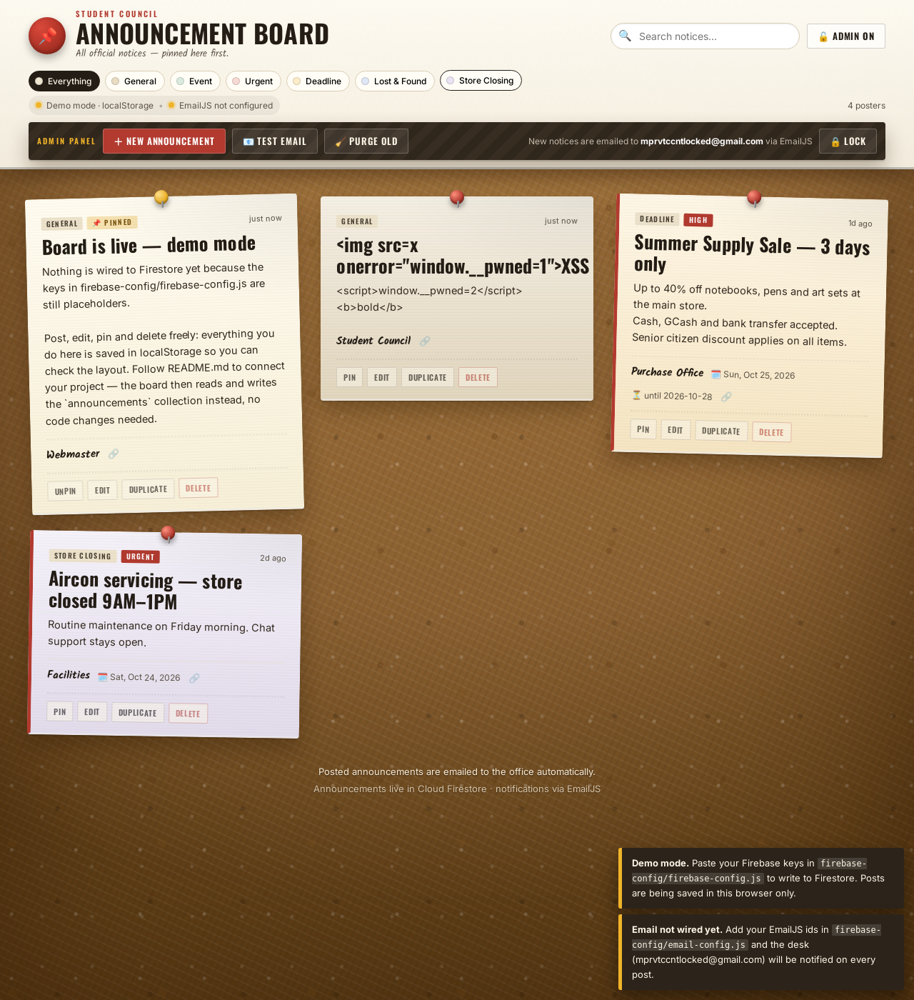
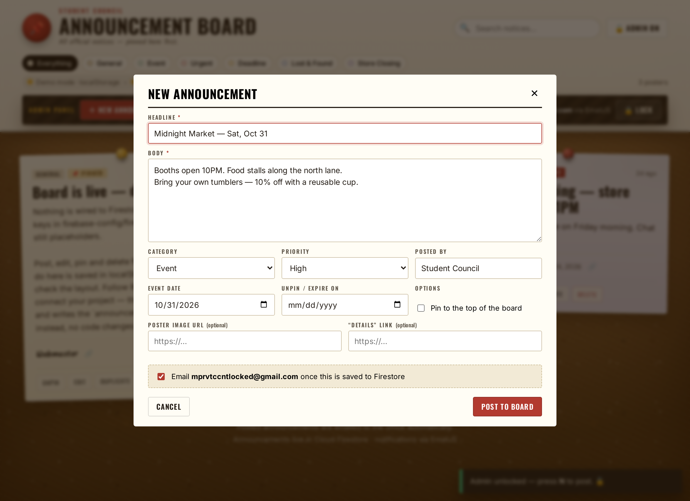

# 📌 Announcement Board — Firestore + EmailJS

A single-page bulletin board. Visitors read pinned posters; an admin posts,
edits, pins and deletes them. Every announcement is stored in **Cloud
Firestore** in the `announcements` collection, and after a write succeeds the
desk is notified by email at **mprvtccntlocked@gmail.com** through **EmailJS**.

No build step, no framework — plain ES modules + one stylesheet.

Firebase is loaded from the version pinned in the brief:
`https://www.gstatic.com/firebasejs/10.8.0/…`.

| The board (demo mode) | The admin composer |
|---|---|
|  |  |

---

## 1. File map

```
announcement-board/
├── index.html                      board + composer + admin PIN dialog
├── css/styles.css                  cork-board theme (no image assets)
├── js/
│   ├── app.js                      UI, filters, admin gate, wiring
│   ├── email.js                    EmailJS notify (SDK → REST fallback)
│   ├── store-firestore.js          reads/writes for the live board
│   └── store-local.js              same interface on localStorage (demo mode)
├── firebase.js                     ← your snippet: initializeApp + getFirestore
├── firebase-config/
│   ├── firebase-config.js          ⚠️ paste Firebase keys here
│   ├── email-config.js             ⚠️ paste EmailJS ids here
│   └── site-config.js              org name, categories, admin PIN
├── firestore.rules                 production rules (public read / admin write)
├── firestore.rules.open            starter rules (everything open — testing)
├── assets/                         the two screenshots above
└── firebase.json                   `firebase deploy` config
```

`firebase.js` is imported **dynamically** by `app.js` only once your keys are
filled in, so the site boots and is clickable before you configure anything.

## 2. Run it

Because the code uses native ES modules it must be served over http (double
clicking `index.html` = `file://` = blocked by CORS).

```bash
cd announcement-board
python3 -m http.server 8000       # → http://localhost:8000
# or: npx serve .   /   firebase serve --only hosting
```

Out of the box you'll see **DEMO MODE** — three sample posters, saved in
`localStorage`. Everything (post / edit / pin / delete / purge) works so you can
check the layout first.

## 3. Connect Firestore (≈5 min)

1. <https://console.firebase.google.com> → **Add project**.
2. Project overview → ⚙ → **Project settings → Your apps → Web app (`</>`)** →
   register it, then copy the `firebaseConfig` object.
3. Paste those six values into `firebase-config/firebase-config.js`.
4. **Build → Firestore Database → Create database** (start in *production*
   mode, region `asia-southeast1` for the Philippines).
5. Publish the rules from §4.

Collection used: `announcements`. Document fields:

| field | type | notes |
|---|---|---|
| `title` | string | headline (≤ 90 chars in the form) |
| `body` | string | poster text, newlines preserved |
| `category` | string | `general · event · urgent · deadline · lostfound · closing` |
| `priority` | string | `low · normal · high · urgent` |
| `author` | string | office / club / store name |
| `pinned` | boolean | stays at the top of the board |
| `imageUrl` | string | optional poster image (http/https) |
| `link` | string | optional “Details ↗” url |
| `eventDate` | string | `yyyy-mm-dd`, shown as “When” |
| `expiresAt` | string | `yyyy-mm-dd`, after that the poster greys out and hides |
| `createdAt`, `updatedAt` | Timestamp | written with `serverTimestamp()` |

Sorting is done client-side (`pinned` first, then newest) on top of a single
`orderBy("createdAt","desc")`, so **no composite index** is ever required.

## 4. Security rules

**Option A — production** (public read, admin-only write). Copy
`firestore.rules` into *Firestore → Rules*, then create one document
`allowedAdmins/<your-uid>` in the console after you sign in via Firebase Auth:

```js
allow read:                 if true;
allow create: if isAdmin() && validAnnouncement();
allow update, delete:       if isAdmin();
```

**Option B — just make it work now.** Paste `firestore.rules.open`
(read + write for anyone). Do this only while testing on a URL nobody else
knows: visitors could wipe the board or burn your EmailJS quota.

> The admin PIN (`site-config.js → adminPin`) hides the buttons from visitors;
> it is *not* security — it sits in a public JS file. Rules + Firebase Auth are
> the real gate. If you want the board to be truly admin-only, add
> `signInWithEmailAndPassword` / Google sign-in in `openAdmin()` and switch
> Option A's `allow` lines to `request.auth != null`.

## 5. Connect EmailJS (≈4 min)

1. <https://emailjs.com> → sign up (free plan = 200 emails/month).
2. **Account → API Keys** → copy the **Public key** (never the private key).
3. **Email Services → Connect Gmail** → sign in as `mprvtccntlocked@gmail.com`
   → copy the **Service ID**.
4. **Email Templates → Create template** → copy the **Template ID**.
5. Fill in `firebase-config/email-config.js`:

```js
export const emailJsConfig = {
  publicKey:  "xxxxxxxxxxxxxxxxx",
  serviceId:  "service_gmail",
  templateId: "template_board",
  recipientEmail: "mprvtccntlocked@gmail.com",
  notifyOnUpdate: false,
  notifyOnDelete: false,
  cc: [],
};
```

6. In the template, set **To Email** to `{{to_email}}` (or hard-code
   `mprvtccntlocked@gmail.com` and delete the variable) and paste this body:

```html
<h2 style="margin:0 0 4px">{{title}}</h2>
<p style="margin:0 0 14px;color:#666">
  {{action}} · {{category}} · priority {{priority}} · by {{author}} · {{posted_at}}
</p>
<div style="background:#faf7f0;border-left:4px solid #b23a2f;padding:14px;white-space:pre-wrap">
{{body}}
</div>
<p style="margin:14px 0">🗓 When: {{event_date}} &nbsp;·&nbsp; ⏳ Until: {{expires_at}} &nbsp;·&nbsp; 📌 Pinned: {{pinned}}</p>
<p><a href="{{link}}">Open this notice on the board →</a></p>
<hr />
<p style="font-size:12px;color:#888">Sent automatically by {{board_url}}</p>
```

Subject line: `{{subject}}` (the app already formats it as
`📌 New announcement: …` / `✏️ …` / `🗑️ …`).

Optional: in EmailJS → **Settings → Email Routing**, add
`mprvtccntlocked@gmail.com` as a verified recipient if you use their own
sending service instead of Gmail.

### When does it send?

`onSubmit()` in `js/app.js` writes first, and **only after the write resolves
successfully** does it call `notifyAnnouncement()`. A failed Firestore write
never emails. Delivery result is shown as a toast (`📧 Email sent … / No email
sent — <reason>`), and a bad EmailJS config can never block a post.

Test it with **Admin → 📧 Test email**.

## 6. Deploy

```bash
npm i -g firebase-tools
firebase login
firebase use --add                      # pick the project from §3
firebase deploy --only hosting,firestore.rules
```

`firebase.json` already serves this folder and publishes `firestore.rules`.
Any static host works too (GitHub Pages, Netlify, Vercel) — just make sure the
URL is https, since EmailJS and Firebase both reject `http://` origins.
Add your hosting domain in **EmailJS → Account → API Keys → Allowed origins**
if you restrict it.

## 7. Troubleshooting

| symptom | cause / fix |
|---|---|
| “Demo mode” banner never goes away | placeholders still in `firebase-config.js` — every value must not start with `YOUR_` |
| toast: `Missing or insufficient permissions` | rules from §4 not published, or you edited them in the console but the site uses the deployed file |
| toast: `Failed to execute 'import'` / blank page on `file://` | you opened the file directly — serve over http (§2) |
| `App named '[DEFAULT]' already exists` | `firebase.js` got imported twice — keep `initializeApp` in that single file only |
| `Invalid API key` | wrong `apiKey`/`projectId`, or Firebase project deleted |
| `offline-code / unavailable in offline mode` | browser blocked the gstatic CDN (ad-blocker / CSP) |
| email toast says `EmailJS not configured` | ids not filled in `email-config.js` |
| email fails `Origin is not allowed` | add your domain to EmailJS allowed origins, or use `localhost` there while testing |
| email fails with `EmailJS REST 400` | read the response detail in the toast; verify the service/template IDs and the template's **To Email** and variable names |
| email “sent” but no inbox mail | template **To Email** still says `to@example.com`; set `{{to_email}}`; check spam |
| `quota exceeded` | free plan = 200/month → set `notifyOnUpdate/notifyOnDelete: false` (already default) |
| image not shown | `imageUrl` must be `https://…` and hot-linkable (Google Drive `/file/d/<id>` links must be converted to `/thumbnail?id=<id>&sz=w1000`) |
